<div align="center">

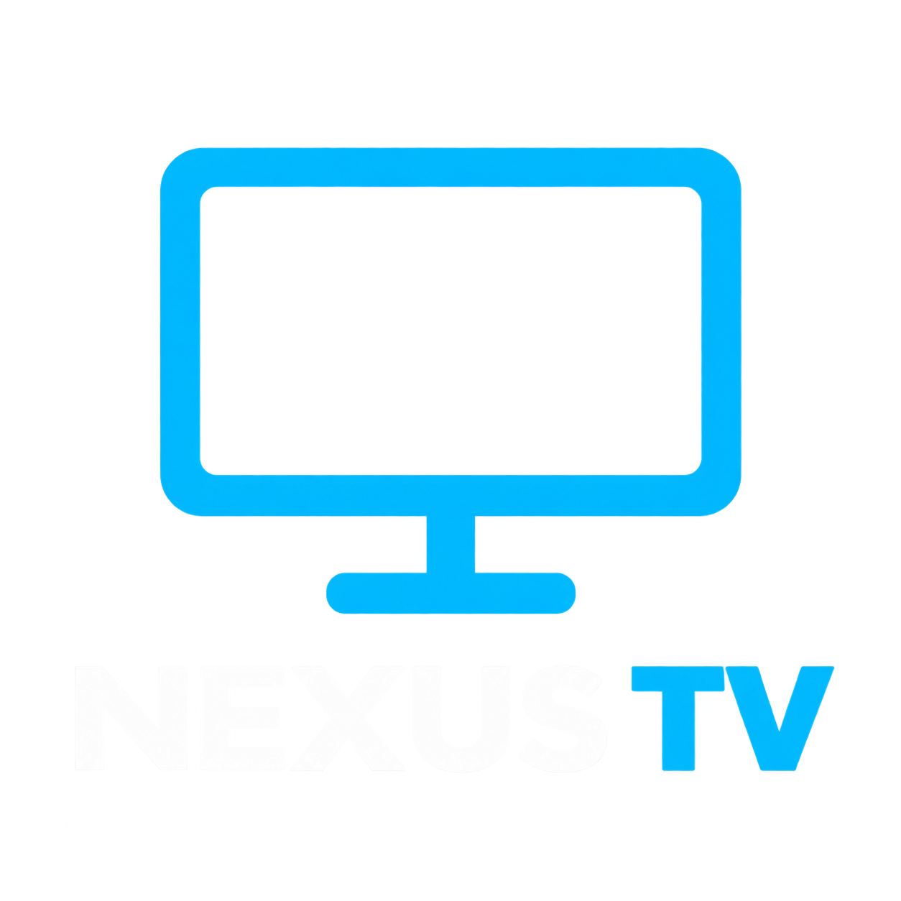

# Nexus TV

**Launcher Moderno, Rápido e Sem Anúncios + Controle Remoto Web PWA Integrado para Android TV & TV Box**

Otimizado para alto desempenho em TV Boxes Rockchip (RK3228A, RK3328, RK3566), Amlogic, AllWinner, Google TV e Fire TV.<br>
Código aberto · Controle Web PWA em tempo real · Integração com Spotify & Notificações Reais do Sistema Android.

[](LICENSE)
[](https://android.com/tv)
[]()
[]()
[]()

</div>

---

## 📺 Visão Geral

O **Nexus TV** é uma evolução moderna e personalizada do FreeMyTV, transformado em um ecossistema completo para Android TV:
1. **Nexus TV Launcher**: Uma interface limpa, moderna e ultrarrápida, sem anúncios ou recomendações forçadas, com barra superior organizada (*Início*, *Filmes*, *Séries*), estante de apps favoritos reordenável e player de música integrado (*Now Playing*).
2. **Nexus Remote (PWA)**: Um controle remoto web completo acessível instantaneamente pelo navegador do celular ou PC via Wi-Fi (`https://<IP_DA_TV>:8765`), sem necessidade de instalar aplicativos externos.
3. **Driver Virtual de Hardware (`nexus_mouse`)**: Daemon nativo em C compilado via NDK que injeta eventos de teclado e mouse diretamente no kernel Linux (`/dev/uinput`), funcionando de forma global em **todos os aplicativos** (YouTube, Stremio, Netflix, UniTV, Navegadores, etc.).
4. **Otimizações de Baixo Nível para TV Box**: Ajustes de kernel para ZRAM (compressão LZO), `swappiness`, `read_ahead_kb` e Interactive Governor para TV Boxes com 1GB ou 2GB de RAM rodarem a 60 FPS estáveis.

---

## 📸 Screenshots

### 🖥️ Interface na TV (Nexus TV Launcher)

| Tela Inicial (Início) | Filmes em Alta |
|:---:|:---:|
| 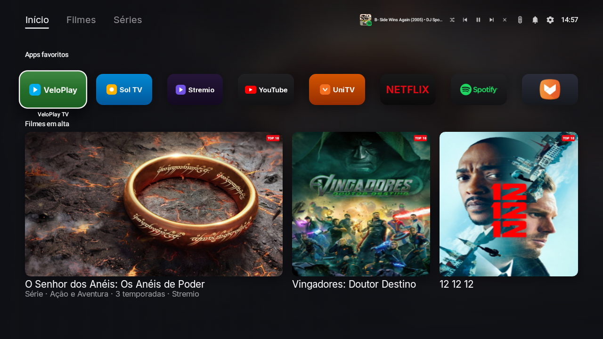 | 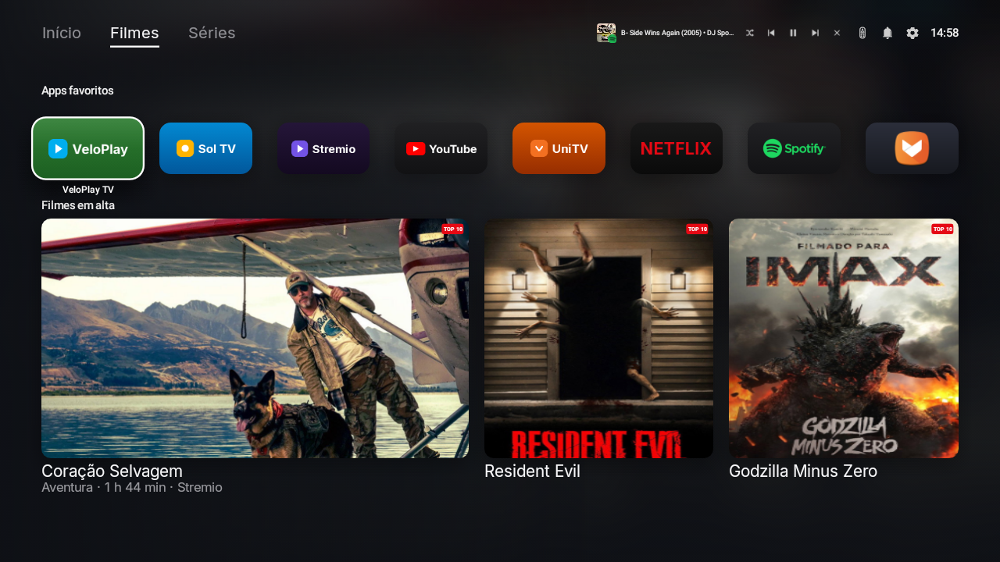 |

| Séries em Alta | Modo Organizar Apps (Long Press) |
|:---:|:---:|
| 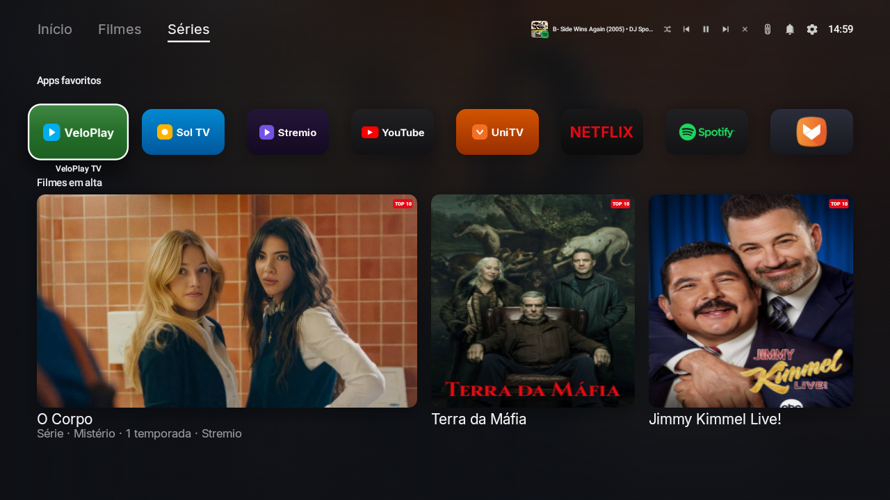 | 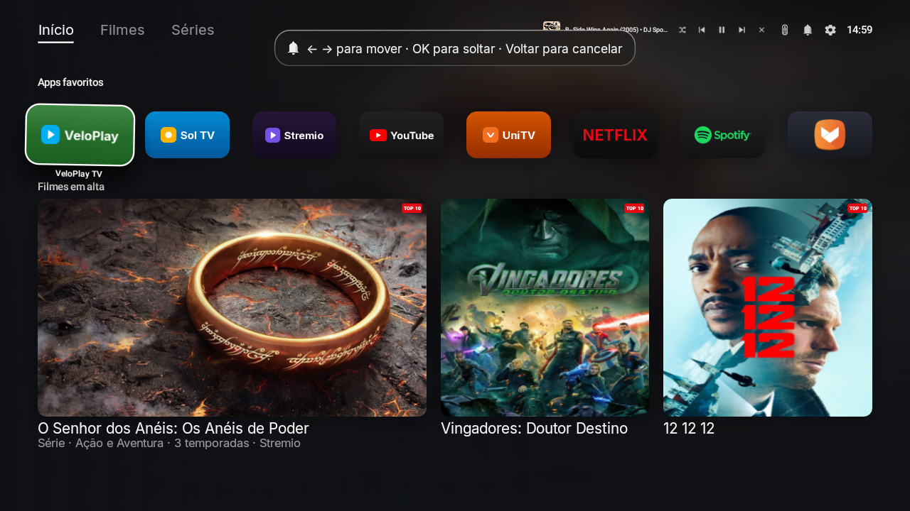 |

| Painel de Notificações na TV | Ajustes do Nexus TV |
|:---:|:---:|
| 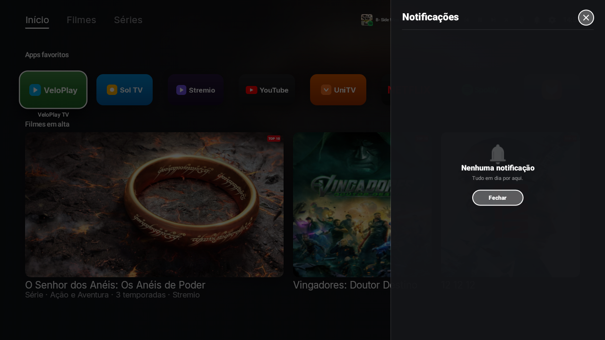 | 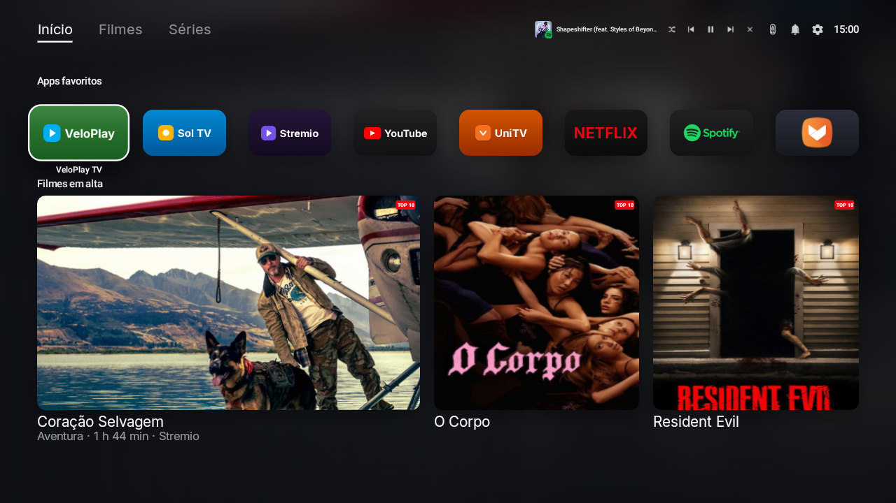 |

---

### 📱 Nexus Remote (Web PWA para Celular em Modo Retrato)

O Nexus Remote funciona diretamente no navegador de qualquer smartphone (iOS / Android) ou computador na mesma rede Wi-Fi:

| 1. Controle Remoto D-Pad | 2. Touchpad Gestual | 3. Player Spotify na TV |
|:---:|:---:|:---:|
| 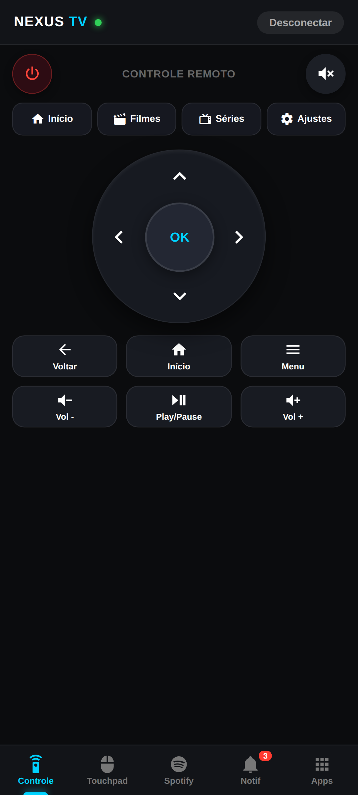 | 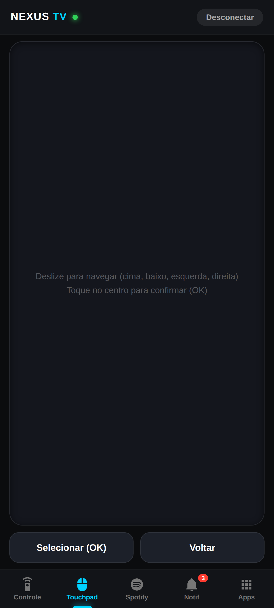 | 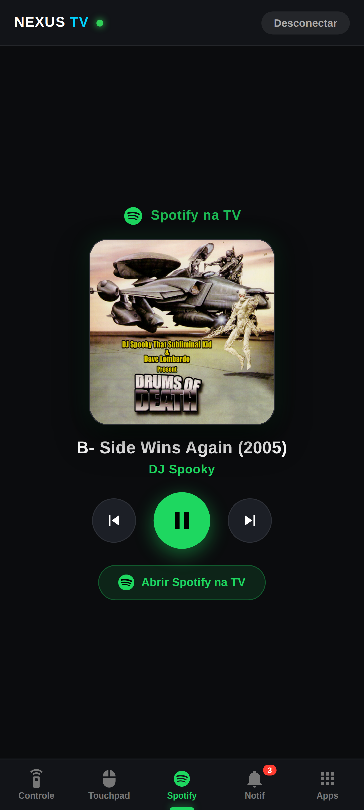 |

| 4. Notificações do Sistema | 5. Apps Favoritos | 6. Conexão por PIN / QR Code |
|:---:|:---:|:---:|
| 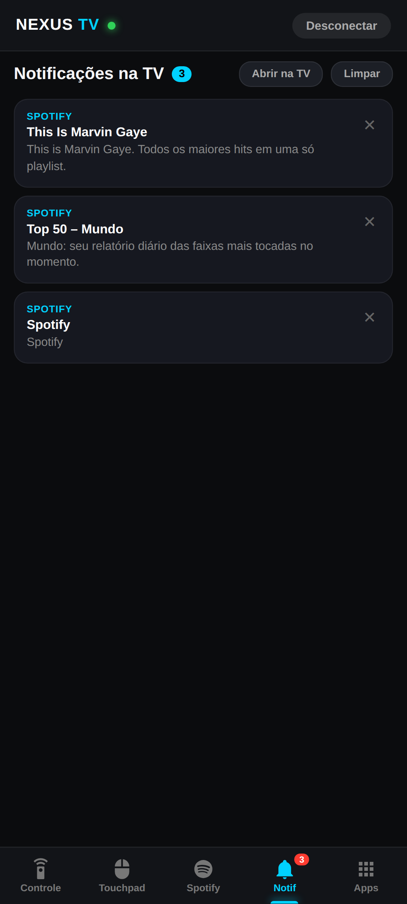 | 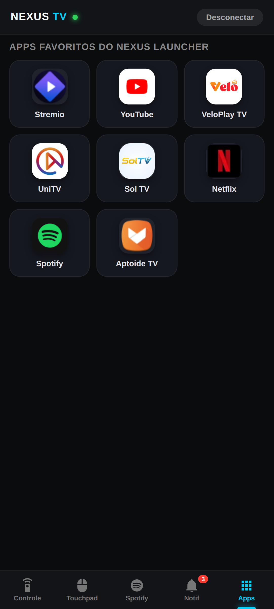 | 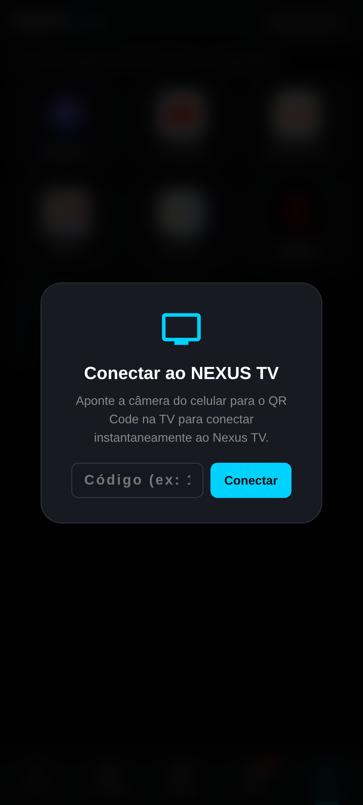 |

---

## ✨ Recursos Principais

### 🎯 1. Nexus Launcher (Interface da TV)
- **Zero Anúncios**: Sem banners patrocinados, vídeos automáticos ou conteúdo intrusivo.
- **Barra Superior Funcional**: Abas *Início*, *Filmes* e *Séries* com recomendações automáticas do TMDB.
- **Widget Now Playing**: Exibe a música em reprodução (faixa, artista, app) no topo da tela com botões de controle direto.
- **Modo Organizar com Gesto Longo**: Segure `OK` sobre qualquer aplicativo na estante para entrar no modo de reordenação (`🔔 ← → para mover • OK para soltar • Voltar para cancelar`). Ao soltar, a posição é salva sem abrir o aplicativo acidentalmente.
- **Gaveta Lateral de Notificações**: Notificações reais do Android acessíveis diretamente na TV com um clique.

### 📱 2. Nexus Remote (Controle Remoto PWA)
- **Zero Instalação**: Abra `https://<IP_DA_TV>:8765` no Chrome, Safari ou Brave.
- **Instalável como PWA**: Adicione à tela de início do celular como um app nativo.
- **Gesto de Aperto Longo e Soltar**: Total compatibilidade com toques normais e long-press tanto no D-pad quanto no botão `OK`.
- **Prevenção de Duplo Clique**: Navegação precisa de 1 bloco por clique, eliminando pulos duplos acidentais.
- **Touchpad Virtual**: Arraste para mover o ponteiro do mouse na TV e use dois dedos para rolar páginas e listas.
- **Controle Total do Spotify**: Capa do álbum em alta definição, nome da faixa, artista, play/pause, avançar/retroceder e controle de volume em tempo real.
- **Central de Notificações Reais do Android**: Sincronização bidirecional com o `NotificationListenerService` do Android. Visualize notificações de apps do sistema e limpe-as individualmente ou todas de uma vez com o botão *Limpar*.
- **Grid de Apps Favoritos**: Lista sincronizada com os apps favoritos da TV para abertura instantânea.

### ⚙️ 3. Driver Nativo Linux Uinput (`nexus_mouse`)
- Emulador de hardware em C puro compilado estaticamente para ARMv7/ARM64.
- Cria dispositivos virtuais `/dev/uinput` independentes:
  - **Teclado puro**: `Nexus Virtual Remote` (Vendor: `0x1234`, Product: `0x5678`) com layout de teclas dedicado (`Vendor_1234_Product_5678.kl`).
  - **Mouse puro**: `Nexus Virtual Mouse` (Vendor: `0x1234`, Product: `0x5679`).
- Suporta comandos UDP de baixa latência (porta `8766`):
  - `K <key>`: Clique único (Down + Up de 25ms).
  - `D <key>`: Pressionar tecla (Key Down - para gestos de long-press).
  - `U <key>`: Soltar tecla (Key Up).
  - `C`: Confirmação segura (sempre `KEY_ENTER` 28, sem risco de clique em falso).
  - `M <dx> <dy>`: Movimento relativo fluido do mouse.
  - `W <wheel>`: Rolagem de scroll vertical.

### 🚀 4. Otimizações de Desempenho para TV Box (RK3228A / Amlogic)
- **ZRAM com Compressão LZO**: Criação de swap comprimido de 384MB na memória RAM, dobrando a capacidade útil em caixas de 1GB/2GB.
- **Swappiness & Cache Pressure**: Otimizado para priorizar retenção de cache de disco e responsividade de interface.
- **Interactive CPU Governor**: Elevação imediata de clock da CPU ao detectar eventos de I/O e toque.
- **Leitura Antecipada da Memória Flash (MMC)**: Buffer de leitura elevado para 512KB (`read_ahead_kb`), acelerando abertura de apps e carregamento de capas.
- **Limpeza Automática de Cache**: Execução periódica de `pm trim-caches` para liberar armazenamento interno.

---

## 🛠️ Como Compilar e Instalar

### Pré-requisitos
- **Computador** (Linux, macOS ou WSL/Git Bash no Windows).
- **JDK 17 ou superior** (`java -version`).
- **Android SDK** com Build-Tools 34+ e Platform android-34 instalados.
- **Android NDK** (para compilar o driver nativo `nexus_mouse.c`).
- **ADB** configurado e conectado à TV Box (`adb connect <IP_DA_TV>:5555`).

### 1. Clonar o Repositório
```bash
git clone https://github.com/WillGolden80742/Nexus-TV.git
cd Nexus-TV
```

### 2. Compilar o Driver Nativo (Opcional se já estiver em assets)
```bash
$ANDROID_NDK_ROOT/toolchains/llvm/prebuilt/linux-x86_64/bin/armv7a-linux-androideabi25-clang \
    -O2 nexus_mouse.c -o app/assets/nexus_mouse
$ANDROID_NDK_ROOT/toolchains/llvm/prebuilt/linux-x86_64/bin/llvm-strip app/assets/nexus_mouse
```

### 3. Compilar o APK
O projeto utiliza um script de compilação direto (`build.sh`), eliminando a sobrecarga e demora do Gradle:
```bash
./build.sh
```
O arquivo `FreeMyTV.apk` será gerado na raiz em segundos.

### 4. Instalar na TV Box
```bash
adb -s <IP_DA_TV>:5555 install -r FreeMyTV.apk
adb -s <IP_DA_TV>:5555 shell "am start -n io.freemytv/.HomeActivity"
```

---

## 📱 Conectando o Nexus Remote

1. Na TV, o launcher inicia automaticamente o servidor seguro na porta `8765`.
2. No celular ou PC, acesse:
   ```text
   https://<IP_DA_TV>:8765
   ```
3. Aceite o certificado SSL autoassinado gerado na primeira inicialização.
4. Digite o código PIN exibido no topo da TV ou aponte a câmera para o QR Code de emparelhamento.
5. O token permanente é salvo no navegador — conexões futuras são automáticas e instantâneas!

---

## 📡 Especificação de Protocolo

### WebSocket (`wss://<IP>:8765/ws`)
Mensagens JSON bidirecionais:
- `{ "type": "key", "key": "right" }`: Disparo de clique de tecla.
- `{ "type": "keydown", "key": "enter" }`: Início de pressão contínua (long-press).
- `{ "type": "keyup", "key": "enter" }`: Soltura da tecla pressionada.
- `{ "type": "pointer", "dx": 10, "dy": -5 }`: Movimento relativo do mouse.
- `{ "type": "scroll", "wheel": -1 }`: Rolagem vertical.
- `{ "type": "nav", "target": "home" | "movies" | "series" | "notif" | "settings" }`: Navegação rápida de abas na TV.
- `{ "type": "notif_clear" }`: Limpa todas as notificações reais do sistema.
- `{ "type": "notif_dismiss", "key": "<key>" }`: Descarta notificação específica.
- `{ "type": "spotify", "action": "playPause" | "next" | "prev" }`: Controle de mídia.

### Daemon UDP Local (Porta `8766`)
- `K <linux_code>`: Tecla rápida.
- `D <linux_code>`: Key Down.
- `U <linux_code>`: Key Up.
- `C`: Enter / Confirmação garantida (key 28).
- `M <dx> <dy>`: Deslocamento do mouse.
- `W <wheel>`: Roda do mouse.

---

## 🤝 Créditos e Agradecimentos

- Baseado no projeto [Free My TV](https://github.com/simbasjungles/free-my-tv) por @simbasjungles.
- Desenvolvido e aprimorado por [@WillGolden80742](https://github.com/WillGolden80742).
- Ícones por [Material Design Icons](https://materialdesignicons.com/) e [Material Symbols](https://fonts.google.com/icons).
- Metadados de streaming por [The Movie Database (TMDB)](https://www.themoviedb.org/).

---

## 📄 Licença

Distribuído sob a licença **MIT**. Consulte o arquivo [LICENSE](LICENSE) para obter mais informações.
